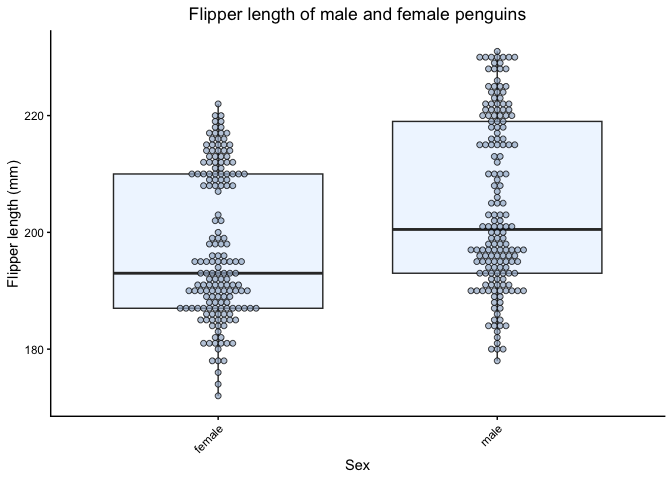
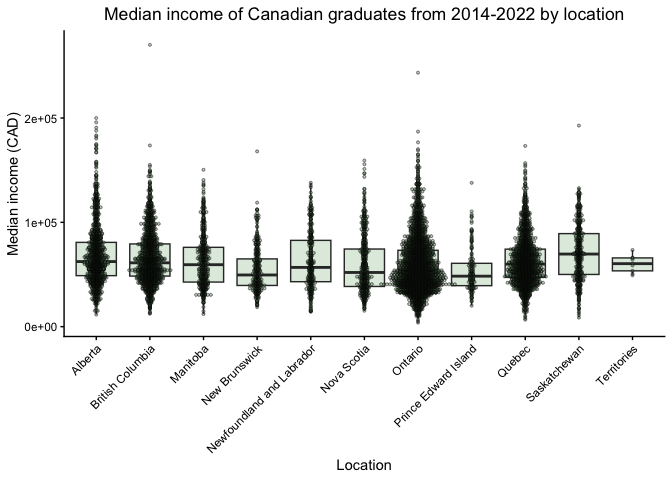

box-dot-plot
================

## Load libraries:

``` r
suppressPackageStartupMessages(library(roxygen2))
suppressPackageStartupMessages(library(tidyverse))
suppressPackageStartupMessages(library(testthat))
suppressPackageStartupMessages(library(palmerpenguins))
suppressPackageStartupMessages(library(diversedata))
```

## Function to create a plot with boxes and dots plotted:

``` r
#' @title Boxplot and dotplot
#' @description
#' This function plots a boxplot and dotplot (on one plot) of values
#' of a numerical variable by a categorical variable
#'  
#' @param dataset dataset to plot from
#' @param cat a categorical variable plotted on the x axis, named to make sure the categorical variable is inputted here
#' @param num a numerical variable plotted on the y axis, named to make sure the numerical variable is inputted here
#' @param dropNA choose whether to drop rows with NAs in cat or num variables, named to be distinct from drop_na or na.rm functions
#' @param plottitle title of plot as a string, distinct from "title" used in ggplot
#' @param catlabel label of categorical variable on x axis inputted as a string, distinct from "xlab" used in ggplot
#' @param numlabel label on categorical variable on y axis inputted as a string, distinct from "ylab" used in ggplot
#' @param box_color boxplot fill color, input a color as a string (default is "lightsteelblue1")
#' @param dot_color dot fill color, input a color as a string (default is "lightsteelblue3")
#' @param dot_size sets the size of the dot, which also adjusts the binwidth, input a positive number, distinct from "dotsize" in geom_dotplot
#' @param box_alpha boxplot alpha to set transparency (default is 0.3), specific to boxolot alpha
#' @param dot_alpha dot alpha to set transparency (default is 0.7), specific to dotplot alpha
#' 
#' @returns this function returns a combined box and dotplot of a numerical variable plotted by a categorical variable
#'
boxdotplot <- function(dataset, cat, num, dropNA, plottitle, catlabel, numlabel, dot_size,
                       box_color = "lightsteelblue1", dot_color = "lightsteelblue3", #the remaining variables have default settings
                       box_alpha = 0.3, dot_alpha = 0.7){
  if(is.numeric(dataset |> #checks if categorical variable is numeric
                pull({{cat}}))){
    stop("cat cannot be numeric!") 
  }
  
  if(!is.numeric(dataset |> #checks if num is non-numeric
                pull({{num}}))){
    stop("num must be a numeric variable!")
  }
  
  if(dropNA == FALSE){ #error if dropNA is set to FALSE
  stop("NA values must be dropped before proceeding!")
  }
  
  dataset |>
    drop_na({{num}}) |>
    drop_na({{cat}}) |>
    ggplot(aes(x = {{cat}}, y = {{num}})) +
    geom_boxplot(fill = box_color, #adds boxplot with selected or default color fill
                 alpha = box_alpha, #transparency set to 0.3 or selected value
                 outlier.shape = NA) + #removing outlier plotting since all points are plotted in dotplot
    geom_dotplot(binaxis = 'y', #binning along y axis instead of default of x
                 binwidth = sqrt(dot_size), #sets binwidth to the square root of the dot size
                 stackdir = 'center', #stacks dots from the center
                 dotsize = dot_size,
                 fill = dot_color,
                 alpha = dot_alpha) +
    theme_classic() +
    labs(
      title = plottitle, #fills in titles as strings
      x = catlabel,
      y = numlabel) +
    theme(plot.title = element_text(hjust = 0.5)) + #centers plot title
    theme(axis.text.x = element_text(angle=45, vjust=1, hjust=1)) #rotates axis labels 45 degrees with correct alignment
}
```

## Examples:

#### Plotting flipper length by sex in the palmerpenguins dataset with default parameters:

``` r
boxdotplot(penguins, sex, flipper_length_mm, #variables provided in order
           dropNA = TRUE, 
           plottitle = "Flipper length of male and female penguins", 
           catlabel = "Sex", 
           numlabel = "Flipper length (mm)", 
           dot_size = 1)
```

<!-- -->

#### Plotting median income by location in the postgradincome dataset of diversedata:

``` r
boxdotplot(dataset = postgradincome, 
           cat = location,
           num = median_income,
           dropNA = TRUE,
           plottitle = "Median income of Canadian graduates from 2014-2022 by location",
           catlabel = "Location",
           numlabel = "Median income (CAD)",
           dot_size = 200, #dot size must be adjusted considerably depending on scale of numerical variable
           box_color = "darkseagreen", #choosing my own colors
           dot_color = "darkseagreen4",
           dot_alpha = 0.4) #adjusting dot alpha
```

<!-- -->

#### Error when dropNA is set to FALSE:

``` r
boxdotplot(penguins, sex, flipper_length_mm, 
           dropNA = FALSE, #setting dropNA to FALSE or not specifying it will lead to an error,
                            #dropping NAs must be considered
           plottitle = "Flipper length of male and female penguins", 
           catlabel = "Sex", 
           numlabel = "Flipper length (mm)", 
           dot_size = 1)
```

    ## Error in `boxdotplot()`:
    ## ! NA values must be dropped before proceeding!

## Tests:

#### Testing boxplot function:

``` r
test_that("cat cannot be a numerical variable, num must be a numerical variable, and plot labels must be provided", {
    expect_error(boxdotplot(  #expects an error when cat is a numerical variable
                      penguins, cat = body_mass_g, num = flipper_length_mm, dropNA = TRUE, 
                      plottitle = "Flipper length based on body mass", 
                      catlabel = "Body mass (g)",  
                      numlabel = "Flipper length (mm)",
                      dot_size = 1))
    expect_error(boxdotplot( #expects an error when num is not a numerical variable
                      penguins, cat = island, num = species, dropNA = TRUE, 
                      plottitle = "Species by island", catlabel = "Island", numlabel = "Species", 
                      dot_size = 1))
    expect_error(boxdotplot( #expects an error when plot labels are not provided
                      penguins, cat = island, num = species, dropNA = TRUE, 
                      dot_size = 1))
  })
```

    ## Test passed with 3 successes 🥇.
